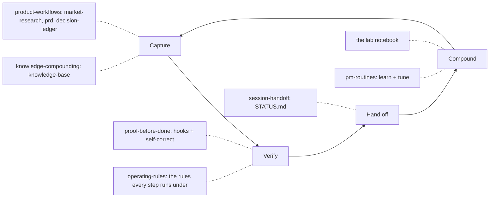

# ai-pm-os

**A product manager's Claude Code workflow, packaged as plugins and measured in public.**

[](https://github.com/nkhanhpham99/ai-pm-os/actions/workflows/ci.yml)
[](LICENSE)
[](CHANGELOG.md)

## How I work with AI agents

I use AI agents across my product work: research, specs, metrics reviews, shipping. They are capable, and they fail in three consistent ways. They are confidently wrong. They forget between sessions. They say "done" before it is done.

Writing better rules did not fix that. When I audited my own setup, the rules were strong and the enforcement was thin: only 1 of 4 hooks could block anything. When I measured, my agent read back its external writes in 8% of the turns that needed it, although a written rule told it to every time.

So my stance is simple. Rules are cheap. Enforcement and measurement are what change behaviour.

I work in a loop. **Capture** what I learn and decide. **Verify** every write and every claim before calling it done. **Hand off** state to a file, not to a session's memory. **Compound**: measure what changed, write it in the [lab](lab/), and adjust. This repo is that loop, packaged so you can install it. The long version is in [docs/how-i-work.md](docs/how-i-work.md).

## The system



| Stage | Question it answers | Where it lives |
|---|---|---|
| Capture | What did I just learn or decide, and where is it written? | `knowledge-base`, `decision-ledger`, `market-research`, `prd` |
| Verify | Did the write land, and is every copy of a fact still true? | `proof-before-done` hooks, `self-correct` |
| Hand off | Can a fresh session pick this up from one file? | `session-handoff` |
| Compound | What did the change do, measured? | the [lab](lab/), the `learn` and `tune` modes of `pm-routines` |

`operating-rules` sits under all four: it puts the eight rules in front of the agent at the start of every session.

## Plugins

Six plugins, nine skills. Each plugin installs on its own.

| Plugin | What it is | Problem it fixes | Evidence | Install |
|---|---|---|---|---|
| [proof-before-done](plugins/proof-before-done/) | Two hooks, a backtest script and the `self-correct` skill. | The agent reports "done" about a write it never read back. A correction gets applied to one copy while stale copies survive. | [Lab 002](lab/002-does-my-agent-verify.md): 45 of 538 write turns (8%) read back. [Lab 003](lab/003-a-fix-that-checks-itself.md): 15 stale claims to 0. | `/plugin install proof-before-done@ai-pm-os` |
| [operating-rules](plugins/operating-rules/) | A SessionStart hook that injects a compact version of the eight rules, under 250 words. | Rules in a long `CLAUDE.md` get skimmed or trimmed out of context. | No entry yet. [Lab 001](lab/001-auditing-my-agent-setup.md) is why it ships next to an enforcing plugin, not instead of one. | `/plugin install operating-rules@ai-pm-os` |
| [session-handoff](plugins/session-handoff/) | A skill that keeps one lean `STATUS.md` current and reads it back before it reports. | A cleared or ended session loses what was done, decided and ruled out. | No entry yet. | `/plugin install session-handoff@ai-pm-os` |
| [knowledge-compounding](plugins/knowledge-compounding/) | The `knowledge-base` skill: explanations become cross-linked, diagrammed markdown entries, written by a background agent. | A good explanation disappears when the session ends, so the same question gets asked again. | No entry yet. | `/plugin install knowledge-compounding@ai-pm-os` |
| [product-workflows](plugins/product-workflows/) | `market-research`, `prd` and `decision-ledger`. | Research mixes sources with guesses, PRDs carry invented targets, and decisions are never checked against what happened. | No entry yet. | `/plugin install product-workflows@ai-pm-os` |
| [pm-routines](plugins/pm-routines/) | `market-sweep`, `weekly-metrics-review` and `watch-until`, plus [scheduling recipes](plugins/pm-routines/SCHEDULING.md). | A scheduled prompt quietly degrades: it pads quiet weeks, skips dead sources without saying so, and never learns. | No entry yet. | `/plugin install pm-routines@ai-pm-os` |

"No entry yet" means what it says. Those plugins carry no impact number until a lab entry measures one.

## Quick start

In Claude Code:

```
/plugin marketplace add nkhanhpham99/ai-pm-os
/plugin install proof-before-done@ai-pm-os
```

Check the hooks loaded with `/hooks`. Install any other plugin the same way. From a local clone, use the clone's path in place of `nkhanhpham99/ai-pm-os`.

Then copy the operating rules. [`templates/CLAUDE.md`](templates/CLAUDE.md) has the eight rules, each with a one-line reason. Copy it into `~/.claude/CLAUDE.md` (every project) or a project's `CLAUDE.md`, and delete any rule you will not enforce. If you also want the compact version injected into every session, install `operating-rules`.

No settings are required. The routines in `pm-routines` interview you once before their first run. To change where a skill writes, add an `## ai-pm-os settings` section to your `CLAUDE.md`. The keys are listed at the end of the template.

### Hand-wiring without plugins

[`templates/settings.example.json`](templates/settings.example.json) wires the same hooks by hand, for anyone who would rather not use plugins. It has two blocks:

- **`permissions.ask`**: commands Claude Code must stop and confirm before running, such as pushes, merges, releases and deploys. This block is independent of the plugins and useful either way.
- **`hooks`**: the `proof-before-done` PostToolUse and Stop hooks and the `operating-rules` SessionStart hook, called by path. Replace `~/path/to/ai-pm-os` with where you cloned the repo.

Merge what you want into `~/.claude/settings.json` or a project's `.claude/settings.json`.

> [!WARNING]
> Use the plugins **or** the `hooks` block, not both. If you install the plugins and also copy the `hooks` block, every hook fires twice.

## The lab

The [lab](lab/) is a notebook of dated experiments on my own setup. Each entry has a hypothesis, one change, a measurement, the result with its source, and a decision. A result not yet measured is written as pending, never predicted.

Latest entries:

- [004: Guardrails that match on text misfire](lab/004-guardrails-that-match-text-misfire.md). A text-matching git guard blocked a harmless script that only contained the text of a dangerous command. Lesson: match parsed commands, not raw strings. Open, fix not built.
- [003: A fix that checks itself](lab/003-a-fix-that-checks-itself.md). A required verify step in `self-correct` caught a stale copy the first pass missed. 12 locations, 15 stale claims, down to 0.
- [002: Does my agent actually verify before saying "done"?](lab/002-does-my-agent-verify.md). 3,731 past turns: 538 wrote to an external tool, 45 (8%) read it back. Follow-up with the hook on: pending.

To suggest an experiment, open an issue with the [experiment idea template](.github/ISSUE_TEMPLATE/experiment-idea.md).

## Design principles

The eight rules behind these plugins are in [`templates/CLAUDE.md`](templates/CLAUDE.md). The plugins follow from them:

- **Enforce what matters.** A rule that matters gets a hook or a required step, not stronger wording.
- **Proof before done.** Every skill reads back what it wrote, and says "not verified" when it cannot.
- **No invented numbers.** Unknowns are written as `needs input`. A claim without a source carries no number.
- **Ask before assuming or spending.** Routines interview you first and stop with a question when their brief is incomplete.
- **Fail open.** Hooks exit silently on any error, so a bug in them can never block your session.
- **Markdown first.** Markdown files are the only tested backend. Notion is documented and marked untested.
- **Portable.** Skills use only the portable [Agent Skills](https://agentskills.io/specification) frontmatter, and read your settings from your own `CLAUDE.md`.
- **The repo checks itself.** A privacy lint, a skill checker, a link checker and regression tests. See [CONTRIBUTING.md](CONTRIBUTING.md).

## About

Khanh Pham is an AI product manager. They built this setup while shipping a consumer app, and keep it in public as a working lab: it changes when a measurement says it should.

- GitHub: [nkhanhpham99](https://github.com/nkhanhpham99)
- LinkedIn: <!-- needs input: LinkedIn URL -->

## Credits and license

Inspiration, not code: [obra/superpowers](https://github.com/obra/superpowers) for skills as a disciplined workflow, [anthropics/skills](https://github.com/anthropics/skills) for the shape of a skill repo, and the [Agent Skills specification](https://agentskills.io/specification) for the portable skill format. No third-party skill content is included.

[MIT](LICENSE). Changes are tracked in the [changelog](CHANGELOG.md).
