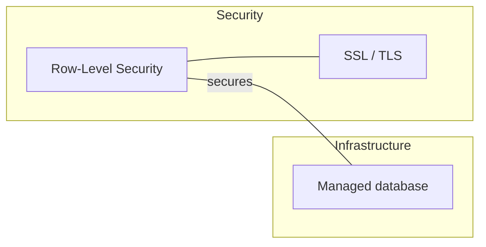

# Meta pages

Every capture updates all three. A new entry that is not in the index, glossary, and map does not exist as far as future navigation is concerned.

The filenames carry a numeric prefix so they sort to the top of any alphabetical file list (digits sort before letters). The reading order is Index, then Glossary, then Map. Use these exact names, with the number and the space:

- `0 INDEX.md` (frontmatter `aliases: [INDEX]`, so `[[INDEX]]` still resolves)
- `1 GLOSSARY.md` (`aliases: [GLOSSARY]`)
- `2 MAP.md` (`aliases: [MAP]`)

Never write a bare `INDEX.md`, `GLOSSARY.md`, or `MAP.md`.

If a meta page does not exist yet (first capture), create it from the formats below.

## `0 INDEX.md`: the table

Every entry is a row. The first column is the clickable link that routes to the page.

````markdown
---
aliases: [INDEX]
---

# Knowledge Base Index

> Maintained by the knowledge-base skill. <N> entries. Updated <YYYY-MM-DD>.
> Navigate: [[GLOSSARY]] for term lookups, [[MAP]] for the visual mind map.

## Concepts

| Concept | In one sentence | Domain | Updated |
|---|---|---|---|
| [[Row-Level Security]] | Filters which rows each database user can see | #security | 2026-01-15 |

## Comparisons

| Comparison | The tradeoff | Case verdicts so far | Updated |
|---|---|---|---|
| [[Option A vs Option B]] | Simplicity vs power | Reporting job: A | 2026-01-15 |
````

The rows above are format examples only. Replace them with the user's real entries.

## `1 GLOSSARY.md`: the term lookup

One alphabetical table of every abbreviation and term of art that appears in any entry, including jargon that was linked but has no page yet. It answers "wait, what did that abbreviation stand for?"

````markdown
---
aliases: [GLOSSARY]
---

# Glossary

| Term | Stands for / means | Full page |
|---|---|---|
| CQRS | Command Query Responsibility Segregation: separate write and read paths | [[CQRS]] |
| RLS | Row-Level Security: per-row database access filtering | [[Row-Level Security]] |
| TTL | Time To Live: how long data stays valid | — |
````

When writing an entry, harvest every abbreviation and term of art you used into the glossary. Terms without a page yet get "—" in the last column. They are lookup-only until a session explains them properly.

## `2 MAP.md`: the mind map

Mermaid graph(s) showing how pages connect. In Obsidian, the `internal-link` class makes nodes clickable. In other renderers it is ignored, so the diagram still draws.

````markdown
---
aliases: [MAP]
---

# Concept Map


````

- Group by domain with subgraphs. Draw edges for the real relationships recorded in the Related sections. Label an edge when the relationship is not obvious: `A ---|"secures"| B`.
- Keep it readable. It is a curated map, not an exhaustive dump. Once the knowledge base grows large (a few dozen entries), split into one mermaid block per domain plus a small cross-domain overview graph.
- Comparisons appear as nodes linked to the concepts they weigh.
